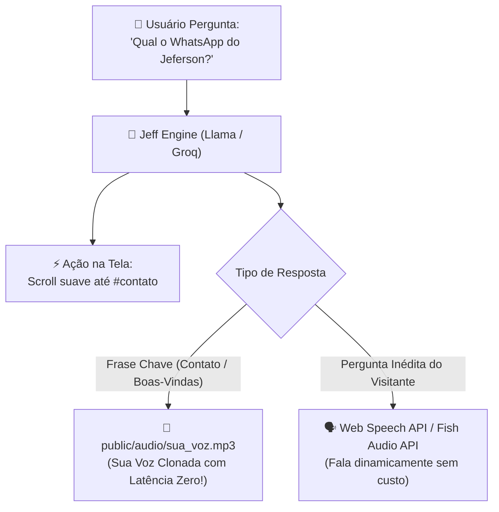

# 🎙️ Guia Definitivo: Clonagem de Voz 100% Gratuita (Fish Audio & F5-TTS)

> **Custo:** R$ 0,00 (Sem mensalidade, sem cartão de crédito).  
> **Ferramenta Principal Recomendada:** [Fish Audio (fish.audio)](https://fish.audio)  
> **Alternativa 100% Open-Source:** [Hugging Face F5-TTS](https://huggingface.co/spaces/mrfakename/E2-F5-TTS)  
> **Tempo para clonar:** Menos de 3 minutos.

---

## 📋 Parte 1: Roteiro para Gravação (30s a 1m)

Grave este texto em um ambiente silencioso usando o gravador do seu celular ou do computador.  
Fale com calma, clareza e firmeza técnica, como se estivesse apresentando seu projeto.

### 📜 Texto para Leitura:
> *"Olá! Eu sou o Jeff, assistente inteligente do portfólio de Jeferson Taveira.*
>
> *Sou Engenheiro de Software focado em backend de alta performance, Inteligência Artificial e sistemas distribuídos.*
>
> *No meu dia a dia, construo soluções com Python, Django, FastAPI, Next.js, Docker, PostgreSQL e modelos de aprendizado de máquina.*
>
> *Se você quiser bater um papo técnico ou agendar uma entrevista com o Jeferson, estou te levando agora para a seção de contatos. O WhatsApp dele é 85 98131-975, e o e-mail é jeferson.taveira@outlook.com.*
>
> *Explore os projetos ao vivo e teste meus recursos interativos!"*

#### 💡 Dicas de Gravação:
- Deixe o microfone a cerca de 15-20 cm da boca para não soprar ar.
- Desligue ventilador ou ar-condicionado por 1 minuto para não gerar ruído no fundo.
- Salve o arquivo no formato `.mp3`, `.m4a` ou `.wav`.

---

## 🚀 Parte 2: Passo a Passo no Fish Audio (Recomendado)

> 🔗 **Link de Acesso Direto:**  
> 👉 **[https://fish.audio](https://fish.audio)**  
> *(Abra este link no navegador para fazer a clonagem gratuita)*

O **Fish Audio** é hoje a melhor plataforma gratuita para clonagem rápida com suporte excelente a português:

### 1. Criar a Conta Gratuita
1. Acesse o link oficial: **[https://fish.audio](https://fish.audio)**
2. No canto superior direito, clique em **"Sign In"** e entre com sua conta do **Google** ou **GitHub** (não pede cartão).

### 2. Criar sua Voz Clonada
1. No menu superior ou lateral, clique em **"Voice"** ou **"Create Voice"**.
2. Clique no botão de criar: **"+ Create Voice"** (ou **"Custom Voice"**).
3. Na janela que abrir:
   - **Voice Name:** `Jeff - Jeferson Taveira`
   - **Language:** Selecione `Portuguese` (Português).
   - **Upload Audio:** Arraste ou selecione o arquivo de áudio que você gravou (ele precisa ter de 10 a 60 segundos).
4. Clique em **"Save"** ou **"Create"**. A sua voz é clonada em **poucos segundos**!

### 3. Gerar os Áudios Chave do Portfólio
Agora você pode digitar qualquer texto para a sua voz falar:
1. Digite a fala que o Jeff deve falar no site:
   - **Áudio de Contato:**  
     *"Estou te levando agora para a seção de contatos do Jeferson. O WhatsApp dele é 85 98131-975."*
   - **Áudio de Boas-Vindas:**  
     *"Sistema ativo. Bem-vindo ao portfólio de Jeferson Taveira. Como posso te ajudar na sua visita?"*
2. Clique no botão de tocar/gerar (**Generate**).
3. Ouça a prévia com a sua voz e clique no botão de **Download (ícone de seta para baixo)** para salvar o arquivo `.mp3`.

---

## 🌐 Opção Alternativa: Hugging Face F5-TTS (100% Aberto)

Se preferir uma ferramenta totalmente descentralizada e sem login:
1. Acesse: **[https://huggingface.co/spaces/mrfakename/E2-F5-TTS](https://huggingface.co/spaces/mrfakename/E2-F5-TTS)**
2. No campo **"Reference Audio"**, faça o upload do seu áudio.
3. No campo **"Reference Text"**, digite uma frase curta do que você falou no início do seu áudio.
4. No campo **"Gen Text"**, digite o que você quer que o Jeff fale (ex: *"Estou te levando agora para a seção de contatos do Jeferson..."*).
5. Clique em **"Generate"**. O áudio com sua voz clonada será gerado e você pode fazer o download do `.wav`.

---

## 🛠️ Parte 3: Como vamos plugar isso no Portfólio

Adotaremos a **Arquitetura Híbrida de Custo Zero e Performance Máxima**:

### 1. Áudios Fixos (Sua Voz Clonada):
Salvaremos os arquivos baixados diretamente em `public/audio/`:
- `public/audio/jeff_contato.mp3`
- `public/audio/jeff_welcome.mp3`
- `public/audio/jeff_resumo.mp3`

### 2. Comportamento no Site:
Quando o usuário perguntar: *"Qual o WhatsApp do Jeferson?"* ou *"Me leva para o contato"*:
- O site **rola suavemente para `#contato`**;
- O áudio `jeff_contato.mp3` **toca com a sua voz real** sem nenhum atraso!
- **Resultado:** O visitante fica impressionado achando que é mágica em tempo real, sem você gastar 1 centavo de servidor!
